# Алгоритм расчёта трассы

Сервис строит двумерные варианты подключения точки здания к существующей теплосети в заданной пользователем области. Маршрут-кандидат и проверка его допустимости — разные этапы: поиск предлагает геометрию, а независимый `VariantValidator` решает, можно ли включить её в результат.

```mermaid
flowchart LR
  A[GeoJSON] --> B[Проверка и проекция]
  B --> C[WGS84 bbox расчёта]
  C --> D[Кандидаты подключения]
  D --> E[A* по графу видимости]
  E --> F[Построение проходов и сети]
  F --> G[Независимая проверка]
  G -->|Допустимо| H[Общие ветви и сочетания]
  H --> I[Стоимость и ранжирование]
  I --> J[Сводка, карта и GeoJSON]
```



## Вход, область и точки подключения

Вход загружается как GeoJSON, проверяется и сохраняется в рамках задания. Идентификаторы сохраняют исходный тип — число и строка остаются разными ID. Геометрические длины, расстояния и отступы рассчитываются после проекции в EPSG:32637; экспортируемые геометрии переводятся в WGS84.

При запуске расчёта клиент передаёт WGS84 bbox в порядке `[запад, юг, восток, север]`. Сервис проецирует эту область для поиска. Для каждой точки подключения он рассматривает подходящие существующие камеры и точки врезки на линиях сети, сортирует кандидатов по расстоянию, ID сети и положению на линии и берёт не более четырёх кандидатов по умолчанию. Поиск точки подключения к сети учитывает допуск камеры 0,25 м и правило размещения врезки из проектного справочника.

Для точки подключения строятся независимые поиски к кандидатам врезки. Отдельные поиски могут исполняться ограниченным пулом из одного–четырёх потоков; по умолчанию — четыре. Результаты собираются в исходном порядке. Подбор сочетаний маршрутов и оптимизация общей сети выполняются после этих поисков.

## Поиск одного маршрута

Маршрутизатор строит граф видимости из точки старта, выбранной точки врезки и граничных точек релевантных препятствий, расширенных на требуемые проектом отступы. Область начинается с коридора вокруг прямого соединения и постепенно расширяется до переданного bbox. Для цели внутри собственного контура здания задаётся прямой конечный подход от ближайшей границы; это исключение применяется только к собственному зданию и не снимает остальные проверки.

Алгоритм использует A*. Стоимость пути — его длина, эвристика — прямое расстояние до врезки. Состояние поиска хранит предыдущую и текущую вершины, чтобы отсекать повороты больше 90 градусов. Ребро графа допускается только после проверок прямой видимости, отступов и специальных пересечений. После нахождения пути геометрия упрощается только там, где прямой отрезок проходит те же проверки.

Если границы препятствий превышают бюджет графа, маршрутизатор заменяет некоторые из них выпуклыми оболочками. Это сокращает набор вершин и может пропустить допустимый вариант; поиск явно помечается неполным. Проверки рёбер продолжают использовать исходные геометрии препятствий. Для ускорения их отбора строится STRtree по расширенным пространственным конвертам; каждый найденный кандидат всё равно проходит прежнюю точную геометрическую проверку. Буферы препятствий повторно используются между максимум четырьмя альтернативами одного пакета и освобождаются после него.

После поиска выбирается минимальный табличный диаметр, достаточный для расхода и полной длины соответствующего пути. Если длина требует большего табличного диаметра, поиск повторяется с изменившимся габаритом и отступом. Специальные проходы формируются прямыми участками; при наложении условий применяется максимальный активный коэффициент стоимости согласно требованиям проекта.

В текущей спецификации проход через дорогу и трамвайную линию продолжается минимум на 3 м за границу пересечения с восстановлением требуемого отступа; для входа также задан угол не менее 45°. Для газопровода, кабеля и существующей теплосети задан прямой проход не короче 2 м по трассе в каждую сторону от пересечения, который также продолжается до восстановления отступа. Коэффициенты этого проекта:

| Объект пересечения | `Kспец` |
|---|---:|
| `road` | 1,60 |
| `tram_tracks` | 1,75 |
| `gas_pipeline` | 1,25 |
| `power_cable` | 1,15 |
| Существующий `heat_network` без врезки | 1,05 |

Эти расстояния и коэффициенты приведены как параметры текущих требований проекта; это не самостоятельная ссылка на универсальные нормативы. Правила и условия наложения проходов реализованы в `RuleCatalog` и проверяются тестами.

## Совместное подключение и ранжирование

В базовом режиме для каждой цели ищутся допустимые отдельные маршруты, затем ограниченное число их сочетаний проверяется как единая сеть. Экспериментальный конкурсный режим `conservative-group-trunks` планирует общие стволы для групп зданий, пробует отводы от уже проверенного дерева, несколько мест врезки и ограниченный просмотр следующих подключений. Проверяется вся сеть: общий участок оплачивается один раз, а изменённый расход может увеличить диаметр и стоимость камеры. Локально короткая ветвь не обязательно экономит итоговую сеть. Режим использует ограниченное портфолио разных деревьев; это поиск кандидатов, а не доказательство глобального минимума. Отклонённое дерево не выдаётся. Сервис возвращает до трёх проверенных и достаточно различных вариантов.

Калькулятор считает цену участков как `длина × цена метра для ДУ × коэффициент прокладки`, добавляет стоимость новых камер и врезок. За каждую отсутствующую в конкретном варианте точку начисляется штраф `100 000 000 + 500 000 × расход_тч`, включая цели с незавершённым поиском. `unsearchedTargetIds` сохраняет причину неполноты как диагностическое подмножество `unconnectedTargetIds`; штраф отражает неполноту выданного варианта, а не доказанную невозможность подключения. Показатель ранжирования:

```text
score = 0.7 × (расчётная_стоимость / 25 000 000)
      + 0.3 × (длина_новой_сети_м / 100)
```

Значения и правила расчёта берутся из текущей спеки и `RuleCatalog`; это параметры данного проекта, а не универсальное заявление о нормативных ценах.

## Независимая проверка и выдача

До ранжирования `VariantValidator` проверяет связность и типизированные ссылки, структуру дерева и примыкания, потоки, табличные диаметры и длины, проекцию, отступы, конечный подход к своему зданию, допустимые повороты и пересечения новых участков. Он также проверяет прямоту и границы специальных проходов и условия для наложенных проходов. Отклонённый маршрут не ранжируется и не экспортируется.

Основные операции API:

| Операция | Назначение |
|---|---|
| `POST /api/jobs` | Загрузить и проверить GeoJSON |
| `GET /api/jobs/{jobId}` | Получить состояние задания и проверки входа |
| `POST /api/jobs/{jobId}/calculate` | Запустить расчёт; тело содержит `{"bbox":[west,south,east,north]}` в WGS84 |
| `GET /api/jobs/{jobId}/variants` | Получить статус поиска, сводки до трёх вариантов, результаты по целям и число проверенных сочетаний |
| `GET /api/jobs/{jobId}/view/extent` и `GET /api/jobs/{jobId}/view` | Получить extent и постранично читать объекты для карты |
| `GET /api/jobs/{jobId}/export` | Скачать FeatureCollection GeoJSON с новыми узлами и сегментами принятых вариантов и их сводками |

Сводка варианта содержит подключённые и неподключённые ID, стоимость, длину и `score`. Результат поиска отдельно перечисляет неисследованные цели и попытки по каждой цели. В GeoJSON сеть представлена сегментами с узлами, расходом, ДУ, длиной, способом прокладки и стоимостью; итоговая запись `variant_summary` содержит стоимость, длину, показатель и ID неподключённых точек. Экспорт не содержит непринятых геометрий.

Формат, правила и границы поиска определяются текущей реализацией и описанием API; эта трасса — двумерный вариант для анализа технологического присоединения, не рабочая документация.
